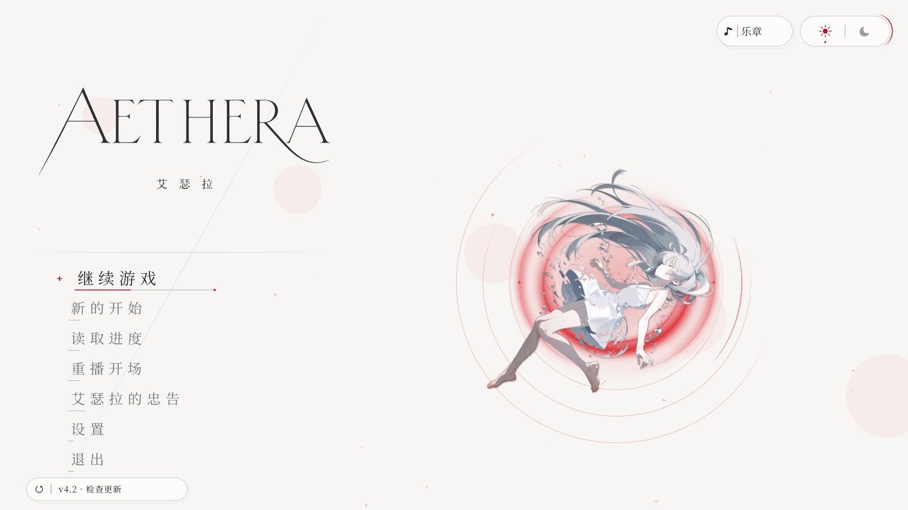
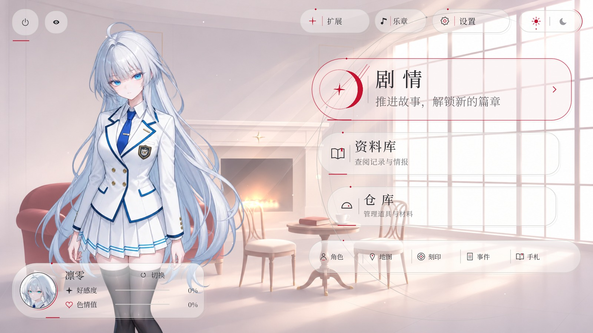
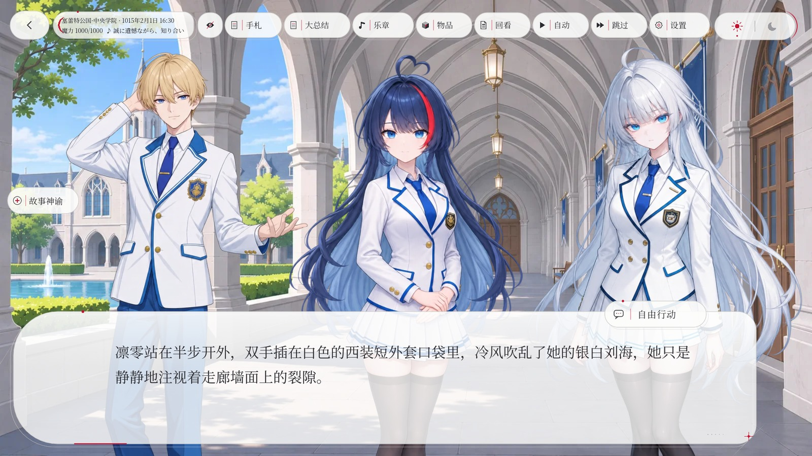
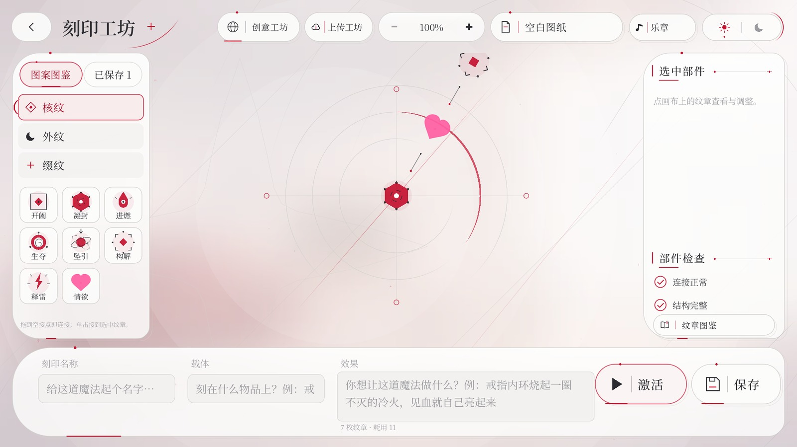

# 《艾瑟拉》（Aethera）

> 《艾瑟拉》又名《艾瑟拉世界》是由明星荧荧Hotaru制作的一款不知道什么类型的游戏，总之就是实现了超进化后变成了现在这样的游戏，嗯。

请根据自己的设备在 [Releases](https://github.com/lumine-423/Aethera/releases) 中下载安装包。

## 游戏截图

| 标题页 | 主页 |
| :---: | :---: |
|  |  |
| **剧情演绎** | **刻印工坊** |
|  |  |

## 仓库说明

- 本仓库**仅用于发布 GitHub Releases 安装包与更新补丁，不再托管或上传工程源码**。
- 主分支 `main` 仅保留本 `README.md` 与 [LICENSE](LICENSE)；需要获取游玩版本请直接前往右侧 [Releases](https://github.com/lumine-423/Aethera/releases) 页面。

## 下载安装（Releases）

请前往 [Releases](https://github.com/lumine-423/Aethera/releases) 页面下载对应平台的最新版本：

- **电脑版（Windows 安装向导，推荐首次安装）**：`Aethera-<版本号>-win64-setup.exe`
- **电脑版（Windows 独立运行/在线覆盖更新包）**：`Aethera-v<版本号>-win64.exe`
- **手机版（Android）**：`Aethera-v<版本号>.apk`
- **苹果版（iPhone / iPad，未签名通用包）**：`Aethera-v<版本号>.ipa`
  - 由于不通过 App Store 分发，`.ipa` 为**未签名安装包**，苹果用户下载后需**自行使用签名 / 侧载工具安装**（如 SideStore、AltStore、Sideloadly、轻松签、巨魔商店 TrollStore 或自备个人 `.p12` 证书签名；使用免费个人 Apple ID 自签时通常需要每 7 天续签一次）。
- 同页另附 `checksums.txt`（SHA256 校验值）与 `app_update.json`（版本更新清单）

游戏内置 **检查更新 / 拉取更新 / 下载更新** 功能（位于标题画面左下角与设置页底部）：打开后可自动检查本仓库最新版 Release 并下载对应平台更新包；Windows 端支持下载 `win64.exe` 后自动覆盖重启，安卓端支持直接下载或唤起系统浏览器直链安装，苹果端支持下载 `.ipa` 至「文件」App 后自行签名安装。

## 版权与使用声明（重要）

- **严禁二次传播 · 严禁商业用途**，作者 **明星荧荧Hotaru** 免费发布，详见 [LICENSE](LICENSE)。
- 内置提示词预设二改自 **创世回廊** 与 **kunlun**，音乐/音效与第三方开源组件分别保留其原著作权及许可协议。
